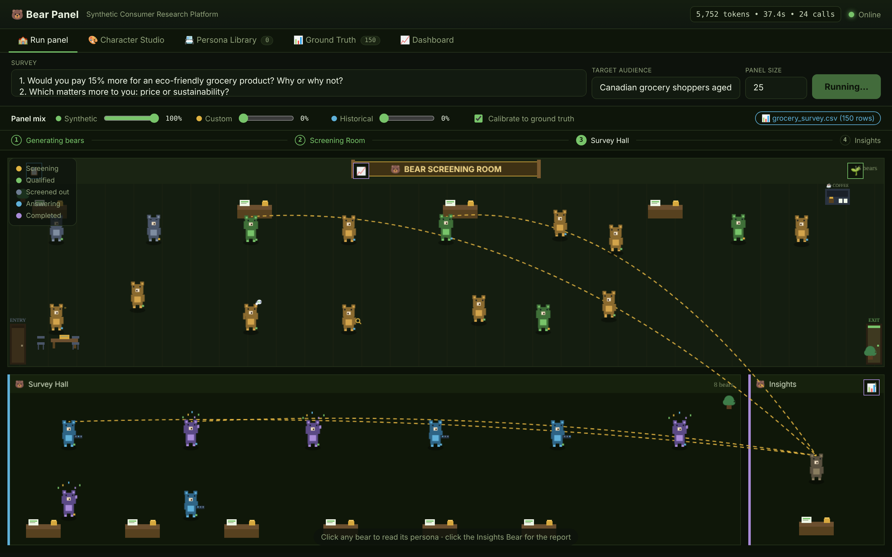
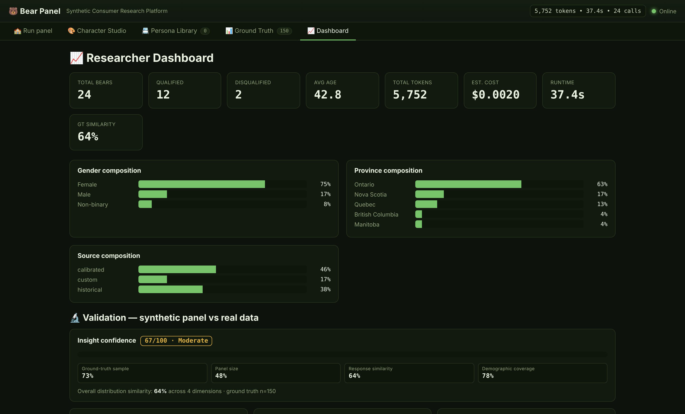
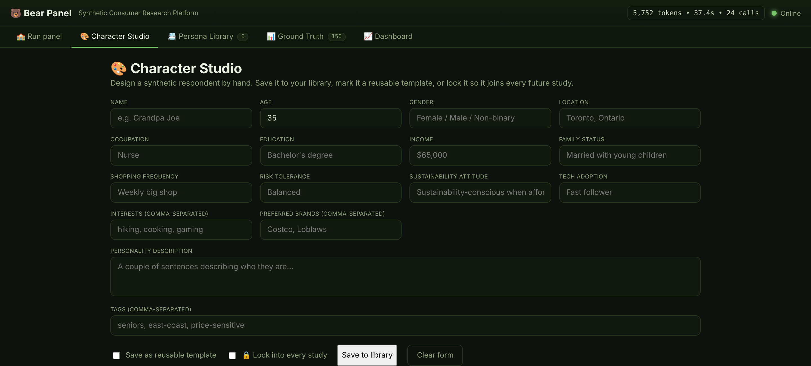

# 🐻 Bear Panel — Synthetic Consumer Research Platform

A bear-themed synthetic survey panel that runs locally on **Ollama** via **CrewAI**.
Each bear is one synthetic consumer with a full persona. You can calibrate the
whole panel to a **real survey dataset**, mix real / custom / AI-generated
respondents, and validate every synthetic study against ground truth — while
keeping the bears.




> The decorated, animated **Screening Room** (top) and **Survey Hall** (bottom): bears walk, chat, and look around while being screened; qualified bears cross to the hall and answer in parallel; dashed links carry their answers to the Survey Insights Bear.

## What it does

A run flows through four phases — **Generating → Screening Room → Survey Hall →
Insights**. Bears are generated per run (no hardcoded roster), screened against a
target audience, answer the survey in parallel and in character, and the Survey
Insights Bear aggregates the results. When a real dataset is loaded, the whole
thing calibrates to it and reports how closely the synthetic panel matches.

Five workspaces (top tabs):

- **🏫 Run panel** — decorated, animated Screening Room; bears walk, chat, look around, celebrate when qualified, walk out when screened out.
- **🎨 Character Studio** — hand-build a respondent; save as a template or lock it into every study.
- **📇 Persona Library** — search, tag, lock, reuse saved personas.
- **📊 Ground Truth** — upload a real survey (CSV / XLSX / JSON); auto-detects columns and models distributions.
- **📈 Dashboard** — totals, average age, composition, tokens, cost estimate, runtime, and validation vs ground truth with an insight confidence score.

### Dashboard & validation



Every study is scored against the uploaded dataset: distribution bars per dimension, a per-dimension match percentage, and a 0–100 insight confidence score broken into its components.

### Character Studio



Build a respondent field by field, save it as a template, or lock it so it joins every future study.

## Repository layout

```
bear-panel/
├── backend/
│   ├── local_swarm.py        # FastAPI + CrewAI backend (the whole engine)
│   └── requirements.txt
├── frontend/
│   └── index.html            # single-file UI (canvas animation + all views)
├── sample_data/
│   ├── grocery_survey.csv     # example ground-truth dataset
│   └── grocery_survey.json    # same data as JSON
├── docs/
│   └── PLATFORM.md           # full feature + API reference
├── run.sh                    # convenience launcher
├── LICENSE
└── README.md
```

## Quick start

```bash
# 1. Local model
ollama pull llama3.1
ollama serve

# 2. Backend
cd backend
python -m venv .venv && source .venv/bin/activate
pip install -r requirements.txt
python local_swarm.py          # http://127.0.0.1:8000

# 3. Frontend
# open ../frontend/index.html in a browser
```

Or just run `./run.sh` from the repo root, then open `frontend/index.html`.

`python-multipart` is required for dataset upload; `openpyxl` is only needed for
`.xlsx` files (CSV and JSON work without it).

## Try it

1. Open the **Ground Truth** tab and upload `sample_data/grocery_survey.csv`.
2. Go to **Run panel**, set the mix (e.g. 50% synthetic / 20% custom / 30% historical), keep **Calibrate** on, and run.
3. Open **Dashboard** to see the validation bars (synthetic vs real) and the insight confidence score.

## How calibration works

With a dataset loaded and **Calibrate** on: synthetic bears sample their
demographics from the real distributions (persona calibration); observed answer
patterns are injected into respondent prompts (response calibration); the
historical slice is built from real rows that voice their actual answers
(audience matching); and the dashboard compares synthetic vs real distributions
across Age, Gender, Geography, Sustainability, and Tech adoption with a
per-dimension similarity score plus an overall figure. Each study gets a 0–100
**insight confidence score** (High / Moderate / Low) from sample size, panel
size, response similarity, and demographic coverage.

See [`docs/PLATFORM.md`](docs/PLATFORM.md) for the full feature list and API reference.

## Notes

- `panel_size` is capped (`MAX_PANEL_SIZE`, default 500); answers run in parallel (`MAX_PARALLEL_AGENTS`, default 6) to stay friendly to local Ollama.
- The cost figure is a "what would this have cost on a hosted model?" estimate — local Ollama itself is free.
- Config via env vars: `OLLAMA_MODEL`, `OLLAMA_BASE_URL`, `MAX_PANEL_SIZE`, `MAX_PARALLEL_AGENTS`, `COST_PER_1M_PROMPT`, `COST_PER_1M_COMPLETION`.

## License

MIT — see [LICENSE](LICENSE).
